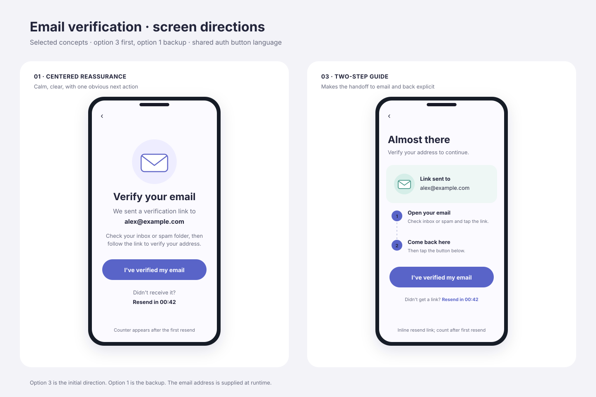
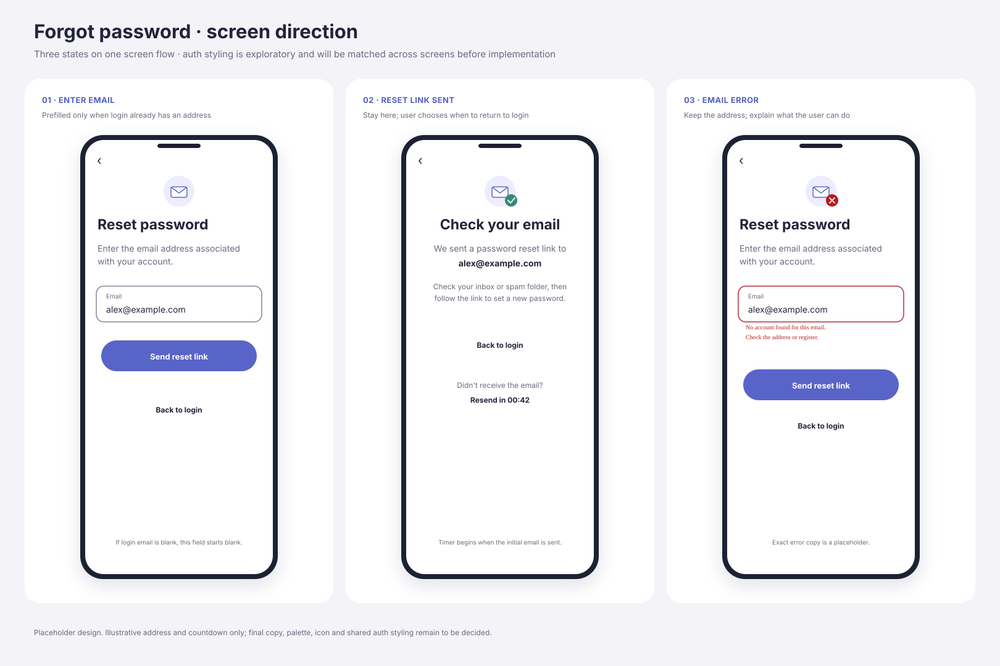

# MediTrack - Design & Implementation Spec

> **Single source of truth.** Every decision or change goes in this document. Agents implement from this file.
> Status: **DRAFT** - planning in progress. Anything marked `OPEN` or `RESEARCH` is not decided; do not implement it until resolved. Ask Or.
> "MediTrack" is a temporary working name (see Section 9).

---

## 0. First Task for the Implementing Agent: Audit and Fix the Project Structure

The repo (`github.com/or-dvir/MediTrack`) contains only the project Android Studio generated when it was created (plus a README, `.gitignore` and `LICENSE`). **Assume nothing is set up and nothing matches this spec.**

Before any feature work:
1. Read this entire spec, the global `rules.md`, and the relevant skills (see Section 8).
2. Do a full scan of the project (Gradle files, version catalog, manifest, package names, themes, dependencies, source sets, tests).
3. Fix everything needed to bring the project in line with this spec, the global rules, and the skills. The agent decides what needs fixing; this spec does not list it.
4. Where the spec is silent, unclear, or marked `OPEN`, ask Or. Do not guess.
5. Things the agent cannot do itself (for example, Firebase projects and their `google-services.json` files) must be reported to Or as prerequisites; never commit `google-services.json`.
6. Verify the result builds with `./gradlew assembleDebug`.

### Firebase project setup (prerequisites to report to Or)
No Firebase project exists yet. When Or creates the Firebase projects (dev and prod, see Section 4), remind Or of these settings. The agent cannot do them itself.
- **Email enumeration protection: OFF** (Firebase console, Authentication, Settings, User actions). It is on by default for projects created on or after September 15, 2023. Turning it off gives specific sign-in errors (for example "no account with this email" vs "wrong password"). Trade-off accepted by Or: the sign-in endpoints can reveal whether an email is registered.
- **One account per email address: ON.** Believed to be under Authentication, Settings, User account linking. The agent verifies the exact location in the current docs.
- **Firestore security rules must require a verified email** (see Section 7.1).

---

## 1. Overview and Priorities

- Personal Android app, built from scratch, to track prescriptions and health-related products across multiple family member profiles, including pets.
- Personal-use tool with no release deadline, so modern APIs and clean architecture are favored over broad compatibility.
- **Speed matters.** The app must feel snappy and responsive. It is not the number one priority, but it must not be neglected for other goals.
- **Safety matters most.** Wrong dosage information can cause harm. See Section 2.9 and Section 3.
- Pure Android (no KMP). Native development in Android Studio.

---

## 2. Features

Status tags: **[MVP]** in the minimum viable product; **[MVP, low priority]** in the MVP but built last and the first to be dropped if the MVP grows; **[FUTURE]** later; **[RESEARCH]** needs research before anything is built.
Or has decided the MVP vs future split for every feature below.

General rules:
- Everything the user creates (profiles, items, history entries) must be editable and deletable.
- Do not add fields "for later" just because it is cheap. Only store data that has a use in the current scope.

### 2.1 Profiles
- [MVP] Single account with multiple sub-profiles (family members and pets), each with a profile picture.
- [MVP] Birth date, **optional** (people may not want to provide it). It never changes and is easy to use, for example to show age. Later it can drive dosage selection.
- [MVP] Default/favorite profile: the app opens straight into it instead of the profile selection screen. UI details (how many favorites, separate from the others vs highlighted or sticky at the top) are decided during UI design.
- Weight, **optional**: not in the MVP. It needs tracking over time and how to do that is `OPEN`.
- [FUTURE] Archive profiles. The archive structure is undecided (per-element archive vs one unified archive screen).

### 2.2 Items (medicines / health products)
- [MVP] Fields: name, description, tags, max daily dosage, multiple pictures.
- [MVP] **Dosage must not be a single value.** It must accommodate multiple conditions, for example "1-2 years: 3ml, 3-5 years: 5ml", by age and/or weight. Frequency can also differ per condition, so dosage and frequency are not necessarily separate fields. The data structure and UI component are `OPEN`. Purpose: avoid dosage mistakes (for example, a child got older and the item was not updated).
- [MVP] Active/inactive state. Inactive items are dimmed and placed at the bottom of the list.
- [MVP] Default sorting is "what I should take next (and when)". This depends on structured frequency data, so feasibility depends on the dosage structure (`OPEN`).
- [FUTURE] Archive items: hide an item but keep its data. An active item cannot be archived, and an archived item is automatically unarchived when set to active. Design note (proposed, not yet confirmed): model active/inactive/archived as one status value instead of separate flags.
- [FUTURE] Opened date and expiry date.
- [FUTURE] Priority/highlight for important items (for example, antibiotics): shown on top, color or other emphasis, stronger notifications. Judgment call kept for now; revisit when implementation details are decided.
- [FUTURE] Favorite items (shortcuts).
- [FUTURE, reconsider] Categories: user-named groups of items inside a profile (for example, "fever reducer"), so the structure becomes profile -> category -> items. Can also be created after the fact by selecting existing items or adding them to an existing category. Tags (MVP) may serve the same purpose, so reconsider before building.

### 2.3 History
(Each time an item is logged as taken.)
- [MVP] Log an item as taken with as few taps as possible. The mechanism is decided during UI design.
- [MVP] Full history of every logged entry per item.
- [MVP] Show last-taken and next-available time per item. Proposed, not yet confirmed: calculate these from the history entries instead of storing them, so edits and deletions correct them automatically.
- [MVP] Edit, delete, and backdate entries. Backdating means adding a manual "taken" entry at a past date and time. Logging in the future is **disabled**. No "edited" marker.
- [FUTURE] Dose warnings: ideally shown before logging if the dose would exceed the max daily dosage or is too soon. The user can still log it; the entry is then flagged (for example, "over limit"). Details when this feature is planned.

### 2.4 Search
- [MVP] Global search across the whole account (not limited to one profile), reachable without extra steps, by name and tag.
- [MVP] Search filters: profile (certain), tag. Other filters are decided when search is designed.
- [FUTURE] Combine search with an archive view (idea, depends on archive).

### 2.5 Account, sync and settings
- [MVP] Firebase Authentication with email/password sign-in and email verification. The user sees data only when signed in **and** verified (see Section 10.1).
- [MVP] Google sign-in. Google accounts do not need the email verification step.
- [MVP] Password reset.
- [MVP] Account deletion: the user can delete their account and all their data from Firebase.
- [MVP] Multi-device sync of all data, offline-first. Firestore provides most of this; images in Firebase Storage need their own loading/caching design.
- [MVP] Disclaimer shown to the user, who must accept it (see 2.9).
- [MVP] Theme selection: system default, always light, always dark.
- [MVP, low priority] App lock (biometric), toggled in settings. Offered to the user after their first login, with a "don't show again" option; always toggleable in settings. Designed together with the settings screen, not the auth screens. If the basic version turns out not to be easy, move it to future.
- [FUTURE] [RESEARCH] Client-side encryption of all data (possibly optional). Note: Firestore already encrypts data at rest and in transit; this would be client-side encryption.

### 2.6 Images
- [MVP] Images are uploaded to Firebase (Firebase Storage; Firestore cannot hold images) so they sync across devices.
- [MVP] Profile pictures **must** be encrypted before upload (they can show people's faces, including children).
- [MVP] Multiple pictures per item, encrypted with the same logic. Whether encryption is a global setting or a per-item/per-profile choice is decided later.
- Rejected alternative: a pointer to a local device image (simpler, but breaks multi-device sync).

### 2.7 Notifications
- [FUTURE] Reminders with options: completely off; only when the item is actively taken; at a specific preset time; custom times. Toggle per item, per profile, or globally (exact structure `OPEN`). Some medicines must be taken at the same time each day; take this into account.
- [FUTURE] Mark an item as taken directly from the notification.
- [FUTURE] Priority items get stronger notifications (for example, non-dismissable). Android may limit non-dismissable notifications; verify before relying on it.
- [FUTURE] Launcher shortcut (Android "app shortcuts", long-press the app icon) to log a dose.

### 2.8 Other future features
- [FUTURE] Export history. Import data.
- [FUTURE] Cross-account family sharing.
- [FUTURE] Multi-language support. Translations are future, but the code must use string resources from day one (no hardcoded user-facing strings).
- [FUTURE] [RESEARCH] Medicine information from official REST APIs, and barcode scanning to auto-fill an item's details. See 2.9 for requirements.

### 2.9 Safety, disclaimer and external data
- The app only helps the user organize things. It is **not medical advice** and the app's author takes no responsibility for what the user does based on it. A disclaimer the user must accept is required (MVP).
- Any external data source (REST API or similar) **MUST be official and reliable** (health authorities such as the FDA or the European equivalents, or the manufacturer). No random open-source libraries or unofficial sources. Several sources, with the user choosing the one relevant to their country, would be best. Which sources exist and are usable is `RESEARCH`.
- If the app ever recommends or highlights a dose (for example, a dosage row matched to a profile's age or weight), it must show a warning and keep on-screen information minimal, so the user is not confused into taking a wrong dose.
- Regulation: an app that provides medical or dosing information may fall under medical-device regulation. This may apply even if the app is only distributed through GitHub and not an app store. `RESEARCH` before relying on any external medical data. Idea to evaluate later: link users to the official source (for example, the FDA page for a medicine) instead of showing the information in the app. Whether that avoids the problem is unknown.

---

## 3. Tech Stack

| Concern | Decision |
|---|---|
| Language | Kotlin, Coroutines + Flow |
| UI | Jetpack Compose, Material Design 3 |
| Architecture | MVVM |
| Dependency injection | Koin |
| Auth | Firebase Authentication (email/password with email verification, Google sign-in, password reset). Google sign-in uses Google's currently recommended method; the agent verifies it in the current docs (the old Google Sign-In library is believed to be deprecated). |
| Database | Firebase Firestore (offline-first, multi-device sync). **Revisit after the spec is complete and before implementation starts** (is a document store the right fit vs a DB-style product?) |
| File storage | Firebase Storage (profile pictures encrypted client-side) |
| Local DB | None (no Room) |
| Networking | REST APIs are wanted eventually (official sources only, see 2.9). Not in the MVP (future, research needed). Library choice `OPEN`. |
| Build config | Gradle Version Catalog (`gradle/libs.versions.toml`), BOMs where available |
| minSdk | 30 (Android 11, about 87% device coverage) |
| compileSdk / targetSdk | Latest (35 or 36) |

### Project structure
- Flat single module (small project). No feature modules.

---

## 4. Conventions Inherited from Global `rules.md`

Source: `github.com/or-dvir/agents-config/rules.md`.

**Conflict rule:** if this spec or any task contradicts `rules.md`, ask Or. A spec entry may override `rules.md` only after Or has approved it, and the entry must say so (for example, "approved by Or").

- Base package: `com.hotmail.or_dvir.meditrack` (may change if the app is renamed; ask before renaming).
- `debug` build type uses `applicationIdSuffix = ".debug"` and `versionNameSuffix = "-DEBUG"`.
- Separate Firebase projects: `app/src/debug/google-services.json` (dev) and `app/src/release/google-services.json` (prod).
- Compose + Material 3 only. No XML layouts, Views, or Fragments.
- `enableEdgeToEdge()` in `MainActivity`; respect scaffold `innerPadding` / `WindowInsets`.
- Theme: System Default / Always Light / Always Dark, persisted with Jetpack DataStore.
- Material 3 expressive styling: tonal containers (`surfaceContainer*`), tinted icon badges, `tertiary` accents. Approved by Or.
- Experimental APIs: a handful is acceptable, but the project must not be flooded with them. The agent lists each experimental API it uses; anything beyond a handful needs Or's approval. Whether to adopt the actual Material 3 Expressive APIs is `OPEN`.
- `ScreenState` data class + `ScreenAction` sealed interface + `onAction(action)` in the ViewModel; state collected with `collectAsStateWithLifecycle()`.
- One-time UI events via `Channel<UiEvent>` only when the ViewModel must push a side effect.
- Previews: combine component states in one preview. Full screens get previews for all relevant states: content, loading, empty, error, and any other relevant state (for example, a single profile vs multiple profiles). Include edge cases such as enough items to fill the screen, so long and short lists can both be seen.
- Gradle properties: `org.gradle.caching=true`, `org.gradle.parallel=true`, `org.gradle.configuration-cache=true`.
- A project-root `AGENTS.md` must exist and inherit global rules (see Section 8).
- Do not refactor existing code unprompted. The agent may suggest changes to existing code; Or explicitly approves or denies each one.

---

## 5. Design Principles

- Modern and not boring: use icons, color, borders, cards and subtle motion so screens do not look like bare default components (for example, two plain text fields on a login screen).
- Within reason: not everything flashy or multicolored, and no composable used just for variety. Simple is sometimes better than flashy. The agent designing the UI judges this case by case, with Or.
- Animations are short. Nothing jumps around, and the user never waits on long animations.
- Fewest possible taps for frequent actions, especially logging an item as taken.
- Field-level errors use one shared standard Android text-field error treatment across the app (the shared `TextBoxError` style/component), including the Material error color. Screens must not invent separate error cards or different spacing/colors for the same text-field error; exact component implementation is an implementation detail.
- **Every text field in the whole app** (not only auth) must have the correct keyboard type, autofill/content-type hint, IME action, and capitalization/autocorrect settings, so password managers and keyboards work properly.

---

## 6. Architecture

- MVVM.
- `OPEN`: whether to adopt the `android-presentation-mvi` skill conventions (State / Action / optional Event, Root + Screen composable split in one file, UI models suffixed `Ui`, `UiText` for resource-based strings).
- `OPEN`: package layout inside the single module.

---

## 7. Data Model and Image Encryption

### 7.1 Data model (Firestore)
`OPEN` - not yet designed. To decide:
- Collections and document structure (account, profiles, items, intake log entries).
- Intake log storage (subcollection under each item vs top-level collection).
- How multi-condition dosage is stored (see 2.2).
- Global search across all profiles of the account (client-side over cached data is the working assumption; Firestore has no full-text search).
- MVP fields to cover: active/inactive state, optional profile birth date, default-profile marker. Future features (archive, opened/expiry dates, weight, categories) must not be stored yet, but the model should not make them hard to add.
- Security rules. They must require a verified email, so unverified users are blocked on the server side too.

### 7.2 Image encryption
`OPEN` - to decide:
- Key management and where the key lives.
- How multiple devices (and later, family members) obtain the key.
- Shared encryption logic for profile and item pictures.

---

## 8. Agent Setup

- Project-root `AGENTS.md` required, following the template in global `rules.md` (identity, tech stack and data sources, key features and screens).
- Related skills live in `github.com/or-dvir/agents-config` (`skills/`). Some skills assume Room, Ktor, REST, multi-module structure, or KMP. **Those parts do not apply to MediTrack.**
- **Read before implementing:** global `rules.md` and the skills in `github.com/or-dvir/agents-config/skills` that are relevant to the work. Where a skill contradicts this spec (or `rules.md`), **stop and ask Or to decide**. Neither side wins automatically. Once Or decides, record the decision in this spec.
- Skill conventions that are **not decided yet** (see Section 9) must not be applied until decided: error handling and navigation.
- Several skills reference skills that are not in the repo (`android-background`, `android-compose-architecture`, `figma-to-android-vector`, etc.). Handle when relevant.

---

## 9. Open Decisions / To Revisit

| Topic | Status |
|---|---|
| Firestore vs DB-style alternative | Revisit after spec is complete, before implementation |
| Error handling (Kotlin `Result<T>` vs custom typed `Result<D, E>`) | Deferred; decide when error handling is discussed |
| Navigation (type-safe Navigation Compose vs Navigation 3) | Deferred until after the spec is complete |
| Firestore data model | Open |
| Image encryption design | Open |
| Dosage structure (multiple conditions, frequency per condition) and its UI component | Open |
| Dose recommendation by profile age/weight, and its warning design | Open, needs careful design |
| Dose warnings (before logging, flag when over limit) | Details when planned |
| Notifications design | Open (Future feature) |
| Priority/highlight design | Open |
| Official APIs and barcode scanning: which sources exist | Research needed |
| Regulation (medical-device rules, also for GitHub-only distribution); link-to-official-source idea | Research needed |
| UI screens and navigation flow | In progress: screens are designed one at a time (see Section 10). Login is decided; registration is in progress elsewhere; verification direction is selected; forgot password is in design review. Discuss auth transitions after the individual auth screens; disclaimer last. |
| Flow between the auth screens | To discuss after the individual auth screens are done |
| Color palette, app icon, tagline and other placeholder texts | Placeholders for now (Material 3 default colors); decide before release |
| Placeholder resolution | Resolve all design placeholder text and assets before implementation starts. Runtime values (for example, the email address passed to verification) are not unresolved design placeholders. |
| Cross-screen visual consistency | Before implementation starts, review all screen designs together and align shared UI elements and styling across the app (see Section 5). |
| Automatic verification refresh | Decide whether to check verification status once when returning to the app, in addition to the manual button; no continuous polling is planned. |
| Login screen variants (stacked centered header, Register on the forgot-password row) | Option 2 is implemented; decide on a real device whether to switch (Section 10.2) |
| Auth flow and Firestore security rules | Auth flow in progress (Section 10.1); security rules open |
| Testing approach | Open |
| Image loading library | Open |
| Adopt actual Material 3 Expressive APIs | Open |
| App name (MediTrack is temporary); package and applicationId depend on it | Open |
| Weight tracking over time (optional profile weight) | Open, not in MVP |
| Categories vs tags | Reconsider before building (future) |
| Priority/highlight | Revisit when implementation details are decided |
| Default profile UI (how many, sticky vs separate) | Decided during UI design |
| Quick "log as taken" mechanism | Decided during UI design |
| Client-side encryption of all data | Research (future) |
| Further features | May be added, removed or changed later |

---

## 10. Screens

Screens are designed one at a time. Each screen's decisions are recorded here once the screen is final. The disclaimer screen is designed last.

### 10.1 Authentication flow (general)
- **Own back stack.** All auth screens form a separate flow. Back works between them (for example, verification back to login). Once the user is signed in and verified, no auth screen stays in the back stack or history and the user cannot navigate back to it. The auth flow is shown again only after logout (manual or automatic).
- **App-level auth state, derived from Firebase (not stored separately):** signed out (show login), signed in but not verified (show verification), ready = signed in **and** verified (show the app). Google accounts count as verified. Firebase's "signed in" alone is not enough, because Firebase signs the user in right after registration. The condition for showing the verification screen is "not verified", not "not logged in" or "not registered".
- **Routing is decided only at app launch and after the result of a sign-in attempt**, not continuously. Otherwise a back press from verification to login would bounce straight back to verification.
- **Back from verification returns to login** (approved by Or). Firebase may stay signed in; the app derives the next screen itself.
- Register, forgot password and verification screens have a back button in the top app bar. Login is the root of the flow and has none.
- The verification screen's back button must match the registration screen; confirm the shared treatment when the registration screen is designed.
- Firebase is the source of truth for email verification. The app must not store a duplicate verification flag. The current Firebase user object can be stale, so reload it before checking for a change. How the verification screen triggers this refresh is decided in Section 10.3.
- **Agent must verify, not assume:** (1) calling email/password sign-in while Firebase already has a signed-in user is believed to just replace the session with no special error. This is not confirmed in the docs. (2) Behavior of Google sign-in with an email that already has an email/password account (with "one account per email" on, expect an account-exists-with-different-credential error or automatic linking). Test on the real project and handle it.

### 10.2 Login screen (decided)
**Elements**
- **Header (row):** app icon on the left; app name and a one-line tagline stacked to its right, all left-aligned. The text block takes the remaining width and wraps for long translations or large fonts (no fixed heights). No big hero illustration. The app name and tagline are string resources; the name is temporary. The icon is a placeholder (it will be the app icon, possibly a lighter variation). Tagline placeholder text: "Keep track of your family's medicines" (to be reviewed later). No "Welcome back" title and no stored user name (it would need a new account field without an MVP use, would only show on devices used before, and would show a name before login).
- Email field and password field (with show/hide toggle), bordered (outlined) text fields.
- Login button (pill-shaped, filled).
- "Forgot password?" link.
- "or" divider, then "Continue with Google" (pill-shaped, outlined; follow Google's button branding rules).
- Register line below the Google button: "Don't have an account? Register" (placeholder text, to be reviewed later).

**Text field settings** (applies to all fields, see Section 5): email field gets the email keyboard, email autofill hint, Next IME action, no autocorrect, no auto-capitalization, and trimmed input. Password field gets the password autofill hint and a Done IME action that submits the form.

**Behavior**
- Correct credentials with an unverified email go to the verification screen, not an error.
- Loading: spinner inside the login button. All fields and both sign-in buttons are disabled while a request runs, so a double tap cannot send two requests.
- Layout: the form starts at about 24% of the screen height. About 20dp between the forgot-password row and the Login button. Or may still fine-tune spacing on a real device. The whole screen scrolls (the header scrolls away when the keyboard is open) and stays reachable; it handles large font sizes; on tablets and landscape the form has a maximum width.
- Same email with both methods: honor the user's choice. No "did you mean Google?" popup. One account per email (see Section 0). Show a clear message if a conflict still happens.
- Google sign-in user cancel: no error message shown (proposed, not yet confirmed).

**Errors**
- Be as specific as possible: for example no account with this email, wrong password, offline, too many attempts, disabled account. Specific errors depend on email enumeration protection being off (see Section 0).
- Where the reason cannot be told apart, show a hint instead of a vague message (for example, suggest registering if the user may not have an account).
- Exact texts are decided with Or during design.

**Previews:** content, loading, and each error state (see Section 4).

**Visual design (decided, with two optional variants)**
- **Implement option 2:** the row header and the Register line below the Google button, as above.
- **Optional variant 1:** stacked, centered header (icon, name and tagline centered), form starting at about 28%. Kept in case option 2 does not look good on a real device.
- **Optional variant 2b:** option 2 with "Register" on the same row as "Forgot password?" (left side) and no separate Register line. Kept in case the separate line feels crowded on a real device. Weakness: two links on one row can wrap or look odd with long translations or large fonts, which is why option 2 is the default.
- Variants 1 and 2b are decided by Or on a real device later; the agent implements option 2 unless told otherwise.
- Placeholders to review before release: tagline text, Register text, colors/palette (keep the Material 3 default for now) and the app icon.
- Visual reference: Or's Design canvas "MediTrack - Login screen options" (boards 1, 2, 2b). It is private to Or; ask Or for screenshots if needed.

### 10.3 Email verification screen (design direction selected; details in progress)
**Elements**
- Top app bar with a back button. Its appearance must match the registration screen and remain consistent with the auth flow; the exact shared treatment is confirmed when registration is finalized.
- Short instructions explain that a verification link was sent and ask the user to check their inbox or spam folder. Suggested copy: "We sent a verification link to [email]. Check your inbox or spam folder, then follow the link to verify your address." The sentence is placeholder copy to resolve before implementation. `[email]` is a runtime value supplied by the preceding registration flow, not copy to decide later.
- Primary action: "I've verified my email," using the same filled pill button style as login, registration, and other auth screens. Show loading feedback inside the button while checking.
- Resend action appears as an inline text link in the selected design. Option 2's outlined secondary button was explored but not selected.
- Show a sent-email count only after the first resend (the second email sent overall); count successful sends.

**Behavior**
- The manual primary action reloads the current Firebase user and then reads the refreshed `isEmailVerified` value. Firebase remains the source of truth; do not persist a duplicate app-level flag.
- If verified, continue to the main app and remove the auth flow from the back stack. A brief success indicator in the primary button (for example, a checkmark) is a possible treatment; whether to show it and for how long remains open.
- If not verified, keep the user on this screen and show a clear message nudging them to check the email and try again.
- If the Firebase reload/check itself fails, show a meaningful Firebase error state, distinct from the normal "not verified yet" result.
- Resend is disabled during a 60-second cooldown after the initial verification email and after every successful resend. The cooldown must be enforced in the resend logic as well as in the UI, so other triggers cannot bypass it. A Firebase `TOO_MANY_REQUESTS` response must show a meaningful message and disable the affected action with a 60-second countdown; enforce the same guard in logic, not only in the UI.
- After the cooldown ends, enable resend again. The inline link shows the remaining time while disabled. The sent-email count remains hidden until the first resend.
- Automatic verification refresh on app return is under consideration (Section 9). If adopted, check once on resume rather than continuously polling, and avoid duplicate concurrent checks. It must not send a verification email.
- Preview states should include initial cooldown, resend available, checking/loading, unverified response, Firebase check error, rate-limit error/cooldown, and verified success.

**Visual design options**
- **Implement option 3 first: Two-step guide.** Left-aligned "Almost there" heading, a compact card with the runtime email address, and two numbered instructions: open the email and follow the link, then return to the app. Place the filled "I've verified my email" action below. Show resend as an inline text link with the countdown. Keep this as the initial implementation direction.
- **Backup option 1: Centered reassurance.** Centered email illustration, "Verify your email" heading, short instructions and runtime email, followed by the same filled primary action and inline resend countdown. Keep as an alternative if option 3 does not work well on a real phone; Or may switch to it later.
- The two options share auth-flow button and back-button styling. Final screen designs must be reviewed together and their shared visual elements aligned before implementation (Section 9).
- Copy and colors shown in the design exploration are placeholders; resolve them before implementation. The runtime email value is not a placeholder decision.

**Design reference:** Option 3 is the initial direction; option 1 is the backup.

### 10.4 Forgot-password screen (placeholder design; details in progress)
**Elements**
- Top app bar with a back button, matching the shared auth-flow treatment.
- Email field. If the Login screen's email field was filled when the user opened Forgot password, prefill it; otherwise start blank. The field remains editable and follows the text-field settings in Section 5.
- Primary action: "Send reset link," using the same filled pill style as the other auth screens.
- After Firebase accepts the request, show a confirmation with the runtime email address and ask the user to check their inbox or spam folder. Exact copy is a placeholder.
- Show a text-style "Back to login" action consistently in each screen state. Its final styling and placement must be discussed before implementation.
- Resend is offered as an inline text action with a 60-second countdown. A sent-email count is not currently part of this screen.
- Keep the same small email icon in the same position in every state. The sent state may overlay a success checkmark; an email-related error may overlay an X. Icon choice and styling are placeholders.

**Behavior and errors**
- Send the reset email to the entered address. Once Firebase accepts the send request, remain on the confirmation state and show "Back to login" immediately; do not automatically navigate away or imply the password has already been changed. The user chooses when to return to Login after completing the reset.
- A 60-second resend cooldown starts after the initial email and after every successful resend. Enforce it in the resend logic as well as the UI. A Firebase `TOO_MANY_REQUESTS` response shows a meaningful message and a 60-second countdown on the affected action.
- Show actionable email-related Firebase errors beside the email field using the shared `TextBoxError` treatment from Section 5. Keep the entered address. Request-level failures (for example, offline) get a meaningful screen message. Exact messages are placeholders and should reflect the configured email-enumeration behavior (Section 0).
- Preview states should include blank email, prefilled email, sending/loading, email-related error, request-level error, sent confirmation with cooldown, and resend available.

**Visual design**
- The current three-state design (email entry, link sent, email-related error) is a placeholder for discussion. The image, error copy, text-style "Back to login" action, and palette are not final and must be reviewed with the other auth screens before implementation (Section 9).

---

## 11. Change Log

- Initial draft created from planning decisions so far.
- Spec moved into the MediTrack GitHub repo at docs/SPEC.md (public). The repo copy is the source of truth.
- Added Section 0: repo contains only the Android Studio generated project; first agent task is a full audit and fix against this spec, global rules and skills.
- Conflict rule: when a skill contradicts the spec, the agent asks Or to decide instead of assuming either side wins.
- Major update: features rewritten as a tagged list (MVP / FUTURE / UNDECIDED / RESEARCH) with many new features; removed owner location; added speed and safety priorities, design principles, disclaimer and regulation notes; images uploaded to Firebase; REST APIs wanted eventually; password reset and account deletion added; rules.md conflicts require asking Or; renamed "dose history" to "intake log" and "daily dosage enforcement" to "dose warnings".
- MVP vs future split completed for all features. Renamed "intake log" to "History". Optional birth date added (MVP); weight left open; opened/expiry dates, archive, priority, favorites, categories and dose warnings moved to future; app lock set to MVP low priority; client-side encryption of all data added as future research.
- Added Google sign-in as a second sign-in method (MVP), alongside email/password.
- Screen design started with the authentication flow. Added Section 10 (screens): general auth flow rules, derived auth state and login screen decisions. Added Firebase project setup prerequisites to Section 0, verified-email requirement for security rules, app lock offer after first login, and the rule that all text fields need correct input settings. Change Log renumbered to Section 11.
- Login screen finalized (Section 10.2): row header with tagline, bordered fields, pill buttons, Register line below the Google button; two optional variants recorded. Added open decisions for colors, app icon, placeholder texts and the variants.
- Email verification screen design direction recorded (Section 10.3): implement option 3 first, retain option 1 as backup; add a pre-implementation review to align shared UI styling across all screens.
- Forgot-password screen placeholder recorded (Section 10.4): conditional email prefill, reset confirmation and resend cooldown, shared text-field error treatment, and three discussion states.
