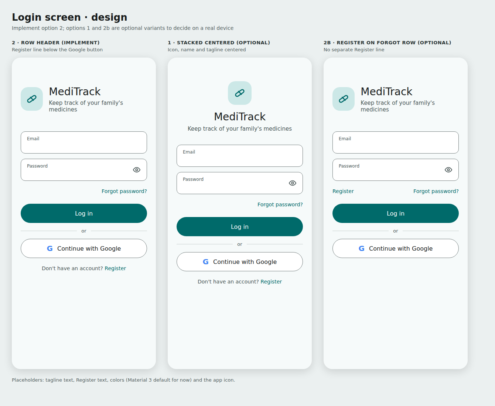
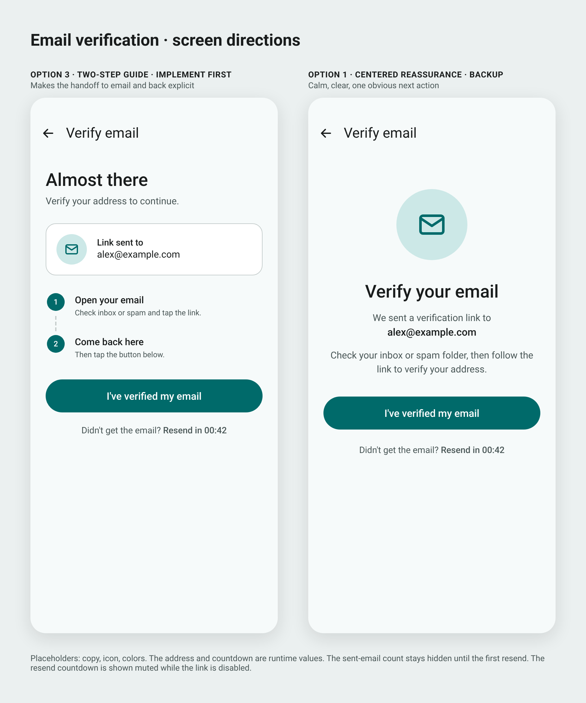
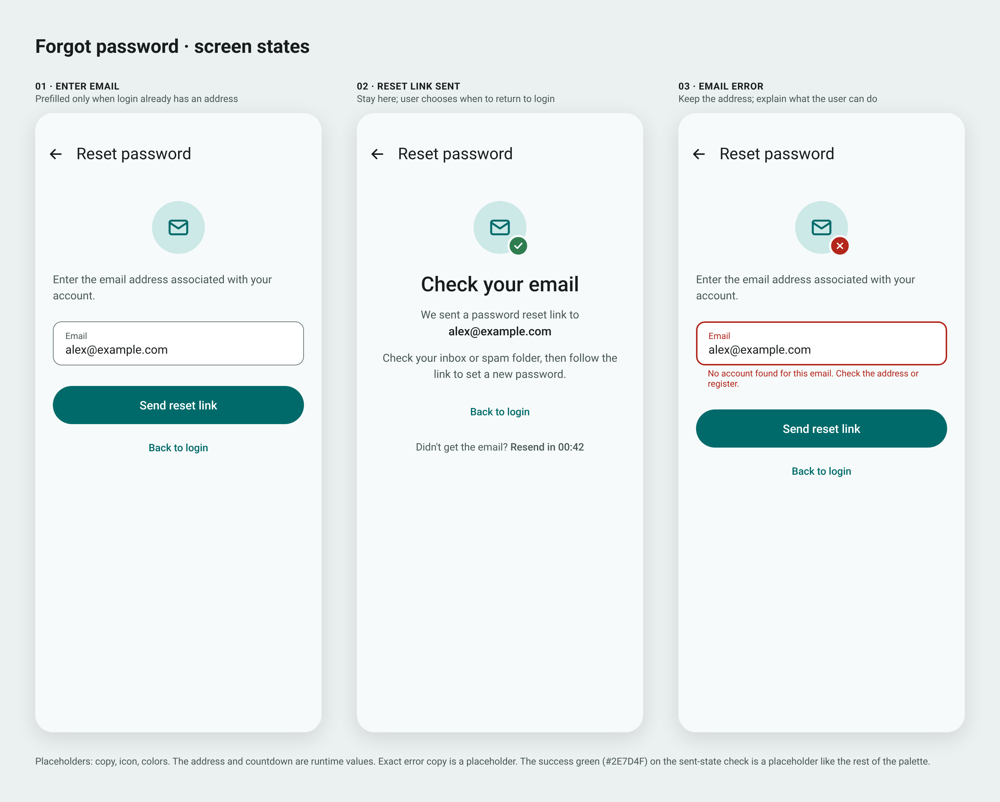
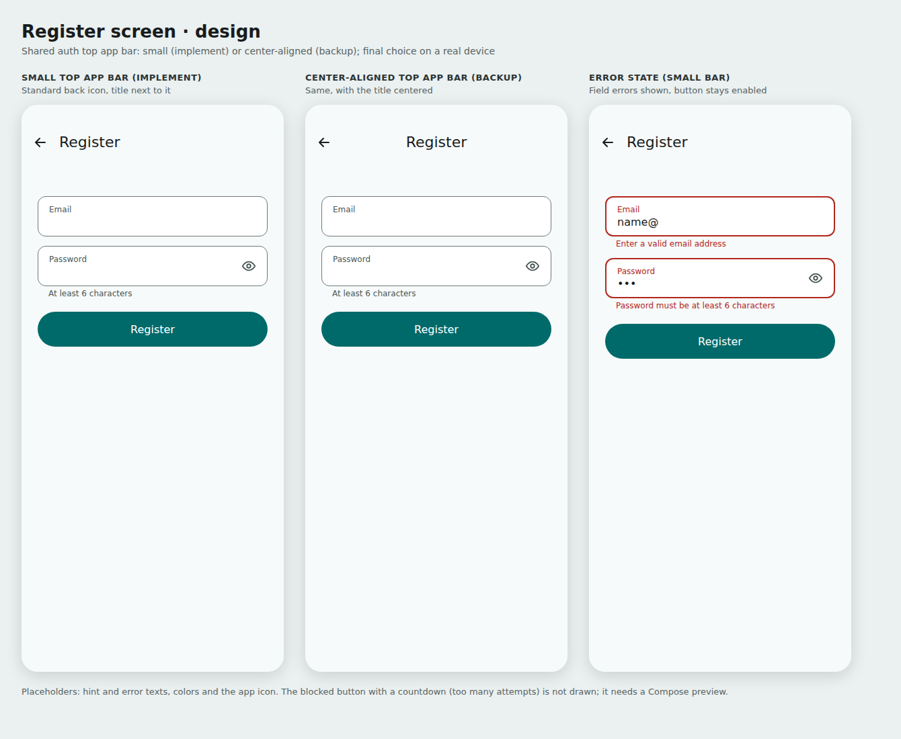
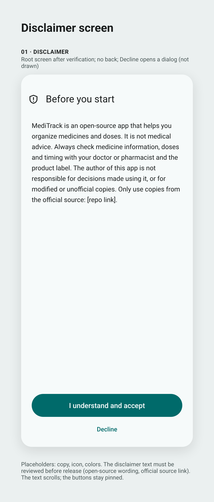
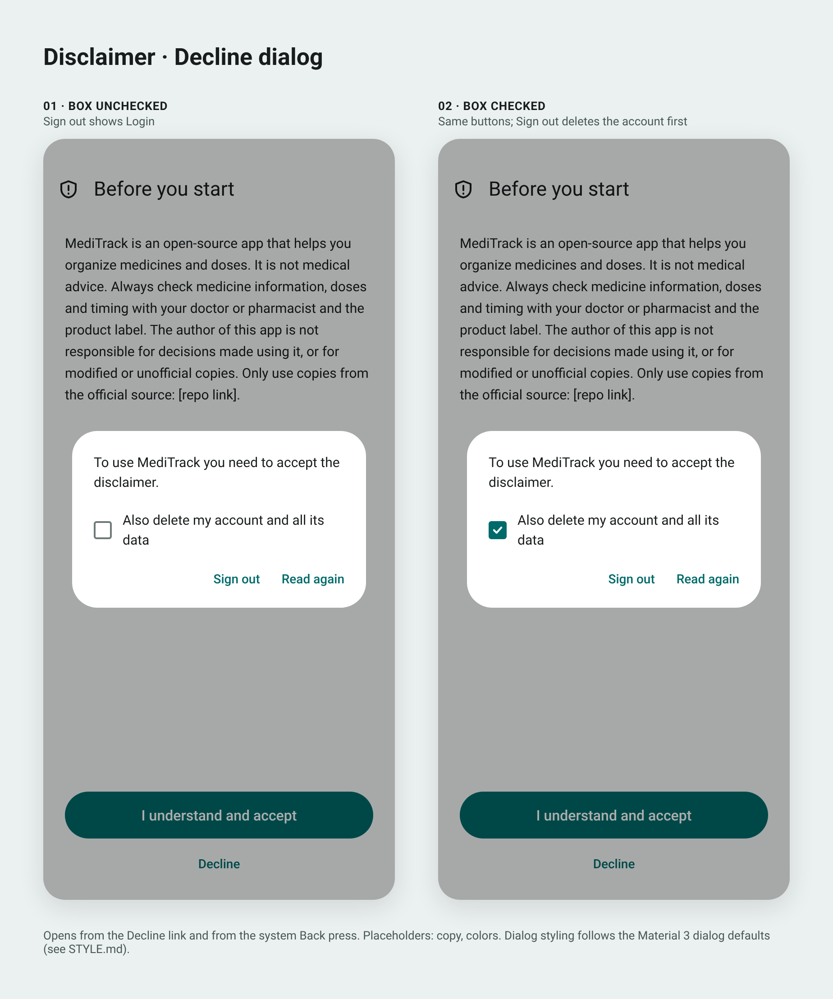

# MediTrack - Design & Implementation Spec

> **Single source of truth.** Every decision or change goes in this document. Agents implement from this file. Status: **DRAFT** - planning in progress. Anything marked `OPEN` or `RESEARCH` is not decided; do not implement it until resolved. Ask Or. "MediTrack" is a temporary working name (see Section 9).

---

## 0. First Task for the Implementing Agent: Audit and Fix the Project Structure

The repo (`github.com/or-dvir/MediTrack`) contains only the project Android Studio generated when it was created (plus a README, `.gitignore` and `LICENSE`). **Assume nothing is set up and nothing matches this spec.**

Before any feature work:

1. Read this entire spec, the global `rules.md`, and the relevant skills (see Section 8).
2. Do a full scan of the project (Gradle files, version catalog, manifest, package names, themes, dependencies, source sets, tests).
3. Fix everything needed to bring the project in line with this spec, the global rules, and the skills. The agent decides what needs fixing; this spec does not list it.
4. Where the spec is silent, unclear, or marked `OPEN`, ask Or. Do not guess.
5. Things the agent cannot do itself (for example, Firebase projects and their `google-services.json` files) must be reported to Or as prerequisites; never commit `google-services.json`.
6. Verify the result builds with `./gradlew assembleDebug`.

### Firebase project setup (prerequisites to report to Or)

No Firebase project exists yet. When Or creates the Firebase projects (dev and prod, see Section 4), remind Or of these settings. The agent cannot do them itself.

- **Email enumeration protection: OFF** (Firebase console, Authentication, Settings, User actions). It is on by default for projects created on or after September 15, 2023. Turning it off gives specific sign-in errors (for example "no account with this email" vs "wrong password"). Trade-off accepted by Or: the sign-in endpoints can reveal whether an email is registered.
- **One account per email address: ON.** Believed to be under Authentication, Settings, User account linking. The agent verifies the exact location in the current docs.
- **Firestore security rules must require a verified email** (see Section 7.1).

---

## 1. Overview and Priorities

- Personal Android app, built from scratch, to track prescriptions and health-related products across multiple family member profiles, including pets.
- Personal-use tool with no release deadline, so modern APIs and clean architecture are favored over broad compatibility.
- **Speed matters.** The app must feel snappy and responsive. It is not the number one priority, but it must not be neglected for other goals.
- **Safety matters most.** Wrong dosage information can cause harm. See Section 2.9 and Section 3.
- Pure Android (no KMP). Native development in Android Studio.

---

## 2. Features

Status tags: **[MVP]** in the minimum viable product; **[MVP, low priority]** in the MVP but built last and the first to be dropped if the MVP grows; **[FUTURE]** later; **[RESEARCH]** needs research before anything is built. Or has decided the MVP vs future split for every feature below.

General rules:

- Everything the user creates (profiles, items, history entries) must be editable and deletable.
- Do not add fields "for later" just because it is cheap. Only store data that has a use in the current scope.

### 2.1 Profiles

- [MVP] Single account with multiple sub-profiles (family members and pets), each with a profile picture.
- [MVP] Birth date, **optional** (people may not want to provide it). It never changes and is easy to use, for example to show age. Later it can drive dosage selection.
- [MVP] Default/favorite profile: the app opens straight into it instead of the profile selection screen. UI details (how many favorites, separate from the others vs highlighted or sticky at the top) are decided during UI design.
- Weight, **optional**: not in the MVP. It needs tracking over time and how to do that is `OPEN`.
- [FUTURE] Archive profiles. The archive structure is undecided (per-element archive vs one unified archive screen).

### 2.2 Items (medicines / health products)

- [MVP] Fields: name, description, tags, max daily dosage, multiple pictures.
- [MVP] **Dosage must not be a single value.** It must accommodate multiple conditions, for example "1-2 years: 3ml, 3-5 years: 5ml", by age and/or weight. Frequency can also differ per condition, so dosage and frequency are not necessarily separate fields. The data structure and UI component are `OPEN`. Purpose: avoid dosage mistakes (for example, a child got older and the item was not updated).
- [MVP] Active/inactive state. Inactive items are dimmed and placed at the bottom of the list.
- [MVP] Default sorting is "what I should take next (and when)". This depends on structured frequency data, so feasibility depends on the dosage structure (`OPEN`).
- [FUTURE] Archive items: hide an item but keep its data. An active item cannot be archived, and an archived item is automatically unarchived when set to active. Design note (proposed, not yet confirmed): model active/inactive/archived as one status value instead of separate flags.
- [FUTURE] Opened date and expiry date.
- [FUTURE] Priority/highlight for important items (for example, antibiotics): shown on top, color or other emphasis, stronger notifications. Judgment call kept for now; revisit when implementation details are decided.
- [FUTURE] Favorite items (shortcuts).
- [FUTURE, reconsider] Categories: user-named groups of items inside a profile (for example, "fever reducer"), so the structure becomes profile -> category -> items. Can also be created after the fact by selecting existing items or adding them to an existing category. Tags (MVP) may serve the same purpose, so reconsider before building.

### 2.3 History

(Each time an item is logged as taken.)

- [MVP] Log an item as taken with as few taps as possible. The mechanism is decided during UI design.
- [MVP] Full history of every logged entry per item.
- [MVP] Show last-taken and next-available time per item. Proposed, not yet confirmed: calculate these from the history entries instead of storing them, so edits and deletions correct them automatically.
- [MVP] Edit, delete, and backdate entries. Backdating means adding a manual "taken" entry at a past date and time. Logging in the future is **disabled**. No "edited" marker.
- [FUTURE] Dose warnings: ideally shown before logging if the dose would exceed the max daily dosage or is too soon. The user can still log it; the entry is then flagged (for example, "over limit"). Details when this feature is planned.

### 2.4 Search

- [MVP] Global search across the whole account (not limited to one profile), reachable without extra steps, by name and tag.
- [MVP] Search filters: profile (certain), tag. Other filters are decided when search is designed.
- [FUTURE] Combine search with an archive view (idea, depends on archive).

### 2.5 Account, sync and settings

- [MVP] Firebase Authentication with email/password sign-in and email verification. The user sees data only when signed in **and** verified (see Section 10.1).
- [MVP] Google sign-in. Firebase decides whether the account is verified; the app never assumes it from the sign-in method.
- [MVP] Password reset.
- [MVP] Account deletion: the user can delete their account and all their data from Firebase.
- [MVP] Multi-device sync of all data, offline-first. Firestore provides most of this; images in Firebase Storage need their own loading/caching design.
- [MVP] Disclaimer shown to the user, who must accept it (see 2.9).
- [MVP] Theme selection: system default, always light, always dark.
- [MVP, low priority] App lock (biometric), toggled in settings. Offered to the user after their first login, with a "don't show again" option; always toggleable in settings. Designed together with the settings screen, not the auth screens. If the basic version turns out not to be easy, move it to future.
- [FUTURE] [RESEARCH] Client-side encryption of all data (possibly optional). Note: Firestore already encrypts data at rest and in transit; this would be client-side encryption.

### 2.6 Images

- [MVP] Images are uploaded to Firebase (Firebase Storage; Firestore cannot hold images) so they sync across devices.
- [MVP] Profile pictures **must** be encrypted before upload (they can show people's faces, including children).
- [MVP] Multiple pictures per item, encrypted with the same logic. Whether encryption is a global setting or a per-item/per-profile choice is decided later.
- Rejected alternative: a pointer to a local device image (simpler, but breaks multi-device sync).

### 2.7 Notifications

- [FUTURE] Reminders with options: completely off; only when the item is actively taken; at a specific preset time; custom times. Toggle per item, per profile, or globally (exact structure `OPEN`). Some medicines must be taken at the same time each day; take this into account.
- [FUTURE] Mark an item as taken directly from the notification.
- [FUTURE] Priority items get stronger notifications (for example, non-dismissable). Android may limit non-dismissable notifications; verify before relying on it.
- [FUTURE] Launcher shortcut (Android "app shortcuts", long-press the app icon) to log a dose.

### 2.8 Other future features

- [FUTURE] Export history. Import data.
- [FUTURE] Cross-account family sharing.
- [FUTURE] Multi-language support. Translations are future, but the code must use string resources from day one (no hardcoded user-facing strings).
- [FUTURE] [RESEARCH] Medicine information from official REST APIs, and barcode scanning to auto-fill an item's details. See 2.9 for requirements.

### 2.9 Safety, disclaimer and external data

- The app only helps the user organize things. It is **not medical advice** and the app's author takes no responsibility for what the user does based on it. A disclaimer the user must accept is required (MVP).
- Any external data source (REST API or similar) **MUST be official and reliable** (health authorities such as the FDA or the European equivalents, or the manufacturer). No random open-source libraries or unofficial sources. Several sources, with the user choosing the one relevant to their country, would be best. Which sources exist and are usable is `RESEARCH`.
- If the app ever recommends or highlights a dose (for example, a dosage row matched to a profile's age or weight), it must show a warning and keep on-screen information minimal, so the user is not confused into taking a wrong dose.
- Regulation: an app that provides medical or dosing information may fall under medical-device regulation. This may apply even if the app is only distributed through GitHub and not an app store. `RESEARCH` before relying on any external medical data. Idea to evaluate later: link users to the official source (for example, the FDA page for a medicine) instead of showing the information in the app. Whether that avoids the problem is unknown.
- When external medicine data is added, update the disclaimer to say that third-party sources are used and that the author is not affiliated with them (see Section 10.7).

---

## 3. Tech Stack

| Concern | Decision |
|---|---|
| Language | Kotlin, Coroutines + Flow |
| UI | Jetpack Compose, Material Design 3 |
| Architecture | MVVM |
| Dependency injection | Koin |
| Auth | Firebase Authentication (email/password with email verification, Google sign-in, password reset). Google sign-in uses Google's currently recommended method; the agent verifies it in the current docs (the old Google Sign-In library is believed to be deprecated). |
| Database | Firebase Firestore (offline-first, multi-device sync). **Revisit after the spec is complete and before implementation starts** (is a document store the right fit vs a DB-style product?) |
| File storage | Firebase Storage (profile pictures encrypted client-side) |
| Local DB | None (no Room) |
| Networking | REST APIs are wanted eventually (official sources only, see 2.9). Not in the MVP (future, research needed). Library choice `OPEN`. |
| Build config | Gradle Version Catalog (`gradle/libs.versions.toml`), BOMs where available |
| minSdk | 30 (Android 11, about 87% device coverage) |
| compileSdk / targetSdk | Latest (35 or 36) |

### Project structure

- Flat single module (small project). No feature modules.

---

## 4. Conventions Inherited from Global `rules.md`

Source: `github.com/or-dvir/agents-config/rules.md`.

**Conflict rule:** if this spec or any task contradicts `rules.md`, ask Or. A spec entry may override `rules.md` only after Or has approved it, and the entry must say so (for example, "approved by Or").

- Base package: `com.hotmail.or_dvir.meditrack` (may change if the app is renamed; ask before renaming).
- `debug` build type uses `applicationIdSuffix = ".debug"` and `versionNameSuffix = "-DEBUG"`.
- Separate Firebase projects: `app/src/debug/google-services.json` (dev) and `app/src/release/google-services.json` (prod).
- Compose + Material 3 only. No XML layouts, Views, or Fragments.
- `enableEdgeToEdge()` in `MainActivity`; respect scaffold `innerPadding` / `WindowInsets`.
- Theme: System Default / Always Light / Always Dark, persisted with Jetpack DataStore.
- Material 3 expressive styling: tonal containers (`surfaceContainer*`), tinted icon badges, `tertiary` accents. Approved by Or.
- Experimental APIs: a handful is acceptable, but the project must not be flooded with them. The agent lists each experimental API it uses; anything beyond a handful needs Or's approval. Whether to adopt the actual Material 3 Expressive APIs is `OPEN`.
- `ScreenState` data class + `ScreenAction` sealed interface + `onAction(action)` in the ViewModel; state collected with `collectAsStateWithLifecycle()`.
- One-time UI events via `Channel<UiEvent>` only when the ViewModel must push a side effect.
- Previews: combine component states in one preview. Full screens get previews for all relevant states: content, loading, empty, error, and any other relevant state (for example, a single profile vs multiple profiles). Include edge cases such as enough items to fill the screen, so long and short lists can both be seen.
- Gradle properties: `org.gradle.caching=true`, `org.gradle.parallel=true`, `org.gradle.configuration-cache=true`.
- A project-root `AGENTS.md` must exist and inherit global rules (see Section 8).
- Do not refactor existing code unprompted. The agent may suggest changes to existing code; Or explicitly approves or denies each one.

---

## 5. Design Principles

- Modern and not boring: use icons, color, borders, cards and subtle motion so screens do not look like bare default components (for example, two plain text fields on a login screen).
- Within reason: not everything flashy or multicolored, and no composable used just for variety. Simple is sometimes better than flashy. The agent designing the UI judges this case by case, with Or.
- Animations are short. Nothing jumps around, and the user never waits on long animations.
- Fewest possible taps for frequent actions, especially logging an item as taken.
- Field-level errors use one shared standard Android text-field error treatment across the app (the shared `TextBoxError` style/component), including the Material error color. Screens must not invent separate error cards or different spacing/colors for the same text-field error; exact component implementation is an implementation detail.
- **Every text field in the whole app** (not only auth) must have the correct keyboard type, autofill/content-type hint, IME action, and capitalization/autocorrect settings, so password managers and keyboards work properly. Leading and trailing spaces are trimmed from all non-password text fields (also after autofill) before validating and submitting; passwords are never trimmed.
- Build shared UI components (for example one custom button composable used by every auth screen) instead of restyling per screen. The mockups in `docs/design` share one style, defined in `docs/design/STYLE.md` (the palette there is a placeholder); they are references for layout and content. The implementation uses one consistent style (see Section 9, cross-screen visual consistency).

---

## 6. Architecture

- MVVM.
- `OPEN`: whether to adopt the `android-presentation-mvi` skill conventions (State / Action / optional Event, Root + Screen composable split in one file, UI models suffixed `Ui`, `UiText` for resource-based strings).
- `OPEN`: package layout inside the single module.

---

## 7. Data Model and Image Encryption

### 7.1 Data model (Firestore)

`OPEN` - not yet designed. To decide:

- Collections and document structure (account, profiles, items, intake log entries).
- Intake log storage (subcollection under each item vs top-level collection).
- How multi-condition dosage is stored (see 2.2).
- Global search across all profiles of the account (client-side over cached data is the working assumption; Firestore has no full-text search).
- MVP fields to cover: active/inactive state, optional profile birth date, default-profile marker, the account document (accepted disclaimer version and time). Future features (archive, opened/expiry dates, weight, categories) must not be stored yet, but the model should not make them hard to add.
- Security rules. They must require a verified email, so unverified users are blocked on the server side too.

### 7.2 Image encryption

`OPEN` - to decide:

- Key management and where the key lives.
- How multiple devices (and later, family members) obtain the key.
- Shared encryption logic for profile and item pictures.

---

## 8. Agent Setup

- Project-root `AGENTS.md` required, following the template in global `rules.md` (identity, tech stack and data sources, key features and screens).
- Related skills live in `github.com/or-dvir/agents-config` (`skills/`). Some skills assume Room, Ktor, REST, multi-module structure, or KMP. **Those parts do not apply to MediTrack.**
- **Read before implementing:** global `rules.md` and the skills in `github.com/or-dvir/agents-config/skills` that are relevant to the work. Where a skill contradicts this spec (or `rules.md`), **stop and ask Or to decide**. Neither side wins automatically. Once Or decides, record the decision in this spec.
- Error handling and navigation are decided (Sections 11.2 and 11.3). A skill convention that contradicts them must not be applied; ask Or.
- Several skills reference skills that are not in the repo (`android-background`, `android-compose-architecture`, `figma-to-android-vector`, etc.). Handle when relevant.

---

## 9. Open Decisions / To Revisit

| Topic | Status |
|---|---|
| Firestore vs DB-style alternative | Revisit after spec is complete, before implementation |
| Firestore data model | Open |
| Image encryption design | Open |
| Dosage structure (multiple conditions, frequency per condition) and its UI component | Open |
| Dose recommendation by profile age/weight, and its warning design | Open, needs careful design |
| Dose warnings (before logging, flag when over limit) | Details when planned |
| Notifications design | Open (Future feature) |
| Priority/highlight design | Open |
| Official APIs and barcode scanning: which sources exist | Research needed |
| Regulation (medical-device rules, also for GitHub-only distribution); link-to-official-source idea | Research needed |
| UI screens and navigation flow | In progress: screens are designed one at a time (see Section 10). Auth screens, auth flow (Section 10.6) and the disclaimer (Section 10.7) are drafted and approved with placeholder palette and copy. Main app screens come later. |
| Color palette, app icon, tagline and other placeholder texts | Placeholders for now (the whole palette in `docs/design/STYLE.md`, including the success color); decide before release |
| Placeholder resolution | Resolve all design placeholder text and assets before implementation starts. Runtime values (for example, the email address passed to verification) are not unresolved design placeholders. |
| Cross-screen visual consistency | All auth mockups now share the style in `docs/design/STYLE.md`. Before implementation starts, do a final review of all screens, including the disclaimer, and align shared UI elements (see Section 5). |
| Login screen variants (stacked centered header, Register on the forgot-password row) | Option 2 is implemented; decide on a real device whether to switch (Section 10.2) |
| Shared auth top app bar (small vs center-aligned) | Small is implemented; decide on a real device (Section 10.1) |
| Auth flow and Firestore security rules | Auth flow decided (Sections 10.1 and 10.6); security rules open |
| Testing approach | Proposed in Section 12. Discuss mocks vs fakes, screenshot tests, tools and naming before implementation. |
| Disclaimer text and Decline dialog wording | Placeholder. Review the specific text before implementation (open-source and forks wording, official source link, legal review, future third-party sources note). Finalize during implementation or straight after, before release. None of this blocks implementation |
| Image loading library | Open |
| Adopt actual Material 3 Expressive APIs | Open |
| App name (MediTrack is temporary); package and applicationId depend on it | Open |
| Weight tracking over time (optional profile weight) | Open, not in MVP |
| Categories vs tags | Reconsider before building (future) |
| Priority/highlight | Revisit when implementation details are decided |
| Default profile UI (how many, sticky vs separate) | Decided during UI design |
| Quick "log as taken" mechanism | Decided during UI design |
| Client-side encryption of all data | Research (future) |
| Further features | May be added, removed or changed later |

---

## 10. Screens

Screens are designed one at a time. Each screen's decisions are recorded here once the screen is final. The disclaimer screen is designed last.

### 10.1 Authentication flow (general)

- **Own back stack.** All auth screens form a separate flow. Back works between them (for example, verification back to login). Once the user is signed in and verified, no auth screen stays in the back stack or history and the user cannot navigate back to it. The auth flow is shown again only after logout (manual or automatic).
- **App-level auth state, derived from Firebase (not stored separately):** signed out (show login), signed in but not verified (show verification), ready = signed in **and** verified (show the app). Whether the user is verified is always read from Firebase, for Google accounts too; the app never assumes it from the sign-in method. Firebase's "signed in" alone is not enough, because Firebase signs the user in right after registration. The condition for showing the verification screen is "not verified", not "not logged in" or "not registered".
- **Routing follows the events listed in Section 10.6**, not continuous re-evaluation. Otherwise a back press from verification to login would bounce straight back to verification.
- **Back from verification returns to login** (approved by Or). Firebase may stay signed in; the app derives the next screen itself.
- Register, forgot password and verification screens have a back button in the top app bar. Login is the root of the flow and has none.
- **Shared top app bar** (register, verification, forgot password): a Material 3 small top app bar with a standard icon button (no background) for back and the screen title next to it. Implement the small top app bar. Backup: center-aligned top app bar (title centered). The final choice is made when implementing, on a real device. The same component and treatment are used on all three screens and the screen title is shown in the bar on all three (approved by Or). A body heading that would repeat the bar title is omitted.
- Firebase is the source of truth for email verification. The app must not store a duplicate verification flag. The current Firebase user object can be stale, so reload it before checking for a change. How the verification screen triggers this refresh is decided in Section 10.3.
- **Agent must verify, not assume:** (1) calling email/password sign-in while Firebase already has a signed-in user is believed to just replace the session with no special error. This is not confirmed in the docs. (2) Behavior of Google sign-in with an email that already has an email/password account (with "one account per email" on, expect an account-exists-with-different-credential error or automatic linking). Test on the real project and handle it.

### 10.2 Login screen (decided)

**Elements**

- **Header (row):** app icon on the left; app name and a one-line tagline stacked to its right, all left-aligned. The text block takes the remaining width and wraps for long translations or large fonts (no fixed heights). No big hero illustration. The app name and tagline are string resources; the name is temporary. The icon is a placeholder (it will be the app icon, possibly a lighter variation). Tagline placeholder text: "Keep track of your family's medicines" (to be reviewed later). No "Welcome back" title and no stored user name (it would need a new account field without an MVP use, would only show on devices used before, and would show a name before login).
- Email field and password field (with show/hide toggle), bordered (outlined) text fields.
- Login button (pill-shaped, filled).
- "Forgot password?" link.
- "or" divider, then "Continue with Google" (pill-shaped, outlined; follow Google's button branding rules).
- Register line below the Google button: "Don't have an account? Register" (placeholder text, to be reviewed later).

**Text field settings** (applies to all fields, see Section 5): email field gets the email keyboard, email autofill hint, Next IME action, no autocorrect, no auto-capitalization, and trimmed input. Password field gets the password autofill hint and a Done IME action that submits the form.

**Behavior**

- Correct credentials with an unverified email go to the verification screen, not an error.
- Loading: spinner inside the login button. All fields and both sign-in buttons are disabled while a request runs, so a double tap cannot send two requests.
- Layout: the form starts at about 24% of the screen height. About 20dp between the forgot-password row and the Login button. Or may still fine-tune spacing on a real device. The whole screen scrolls (the header scrolls away when the keyboard is open) and stays reachable; it handles large font sizes; on tablets and landscape the form has a maximum width.
- Same email with both methods: honor the user's choice. No "did you mean Google?" popup. One account per email (see Section 0). Show a clear message if a conflict still happens.
- Google sign-in user cancel: no error message shown.

**Errors**

- Be as specific as possible: for example no account with this email, wrong password, offline, too many attempts, disabled account. Specific errors depend on email enumeration protection being off (see Section 0).
- Where the reason cannot be told apart, show a hint instead of a vague message (for example, suggest registering if the user may not have an account).
- Exact texts are decided with Or during design.

**Previews:** content, loading, and each error state (see Section 4).

**Visual design (decided, with two optional variants)**

- **Implement option 2:** the row header and the Register line below the Google button, as above.
- **Optional variant 1:** stacked, centered header (icon, name and tagline centered), form starting at about 28%. Kept in case option 2 does not look good on a real device.
- **Optional variant 2b:** option 2 with "Register" on the same row as "Forgot password?" (left side) and no separate Register line. Kept in case the separate line feels crowded on a real device. Weakness: two links on one row can wrap or look odd with long translations or large fonts, which is why option 2 is the default.
- Variants 1 and 2b are decided by Or on a real device later; the agent implements option 2 unless told otherwise.
- Placeholders to review before release: tagline text, Register text, colors/palette (keep the Material 3 default for now) and the app icon.
- Design reference (option 2 to implement; options 1 and 2b optional):

### 10.3 Email verification screen (decided)

**Elements**

- Shared auth top app bar (Section 10.1) with the title "Verify email" (placeholder); back returns to login.
- Short instructions explain that a verification link was sent and ask the user to check their inbox or spam folder. Suggested copy: "We sent a verification link to [email]. Check your inbox or spam folder, then follow the link to verify your address." The sentence is placeholder copy to resolve before implementation. `[email]` is a runtime value supplied by the preceding registration flow, not copy to decide later.
- Primary action: "I've verified my email," using the same filled pill button style as login, registration, and other auth screens. Show loading feedback inside the button while checking.
- Resend action appears as an inline text link in the selected design. Option 2's outlined secondary button was explored but not selected.
- Show a sent-email count only after the first resend (the second email sent overall); count successful sends.

**Behavior**

- The manual primary action reloads the current Firebase user and then reads the refreshed `isEmailVerified` value. Firebase remains the source of truth; do not persist a duplicate app-level flag.
- If verified, continue to the main app and remove the auth flow from the back stack. A brief success indicator in the primary button (for example, a checkmark) is a possible treatment; whether to show it and for how long remains open.
- If not verified, keep the user on this screen and show a clear message nudging them to check the email and try again.
- If the Firebase reload/check itself fails, show a meaningful Firebase error state, distinct from the normal "not verified yet" result.
- Resend is disabled during a 60-second cooldown after the initial verification email and after every successful resend. The cooldown must be enforced in the resend logic as well as in the UI, so other triggers cannot bypass it. A Firebase `TOO_MANY_REQUESTS` response must show a meaningful message and disable the affected action with a 60-second countdown; enforce the same guard in logic, not only in the UI.
- After the cooldown ends, enable resend again. The inline link shows the remaining time while disabled. The sent-email count remains hidden until the first resend.
- Automatic verification refresh (Section 10.6): check silently once when the screen resumes and once at launch, never poll, and avoid duplicate concurrent checks. It never sends a verification email.
- Preview states should include initial cooldown, resend available, checking/loading, unverified response, Firebase check error, rate-limit error/cooldown, and verified success.

**Visual design options**

- **Implement option 3 first: Two-step guide.** Left-aligned "Almost there" heading, a compact card with the runtime email address, and two numbered instructions: open the email and follow the link, then return to the app. Place the filled "I've verified my email" action below. Show resend as an inline text link with the countdown. Keep this as the initial implementation direction.
- **Backup option 1: Centered reassurance.** Centered email illustration, "Verify your email" heading, short instructions and runtime email, followed by the same filled primary action and inline resend countdown. Keep as an alternative if option 3 does not work well on a real phone; Or may switch to it later.
- The two options share auth-flow button and back-button styling. Final screen designs must be reviewed together and their shared visual elements aligned before implementation (Section 9).
- Copy and colors shown in the design exploration are placeholders; resolve them before implementation. The runtime email value is not a placeholder decision.

**Design reference:** Option 3 is the initial direction; option 1 is the backup.

**Note:** this mockup uses the shared style in `docs/design/STYLE.md`. Its colors, icons and copy are placeholders (the whole palette is a placeholder). The implementation uses the shared components and one consistent style (Sections 5, 9 and 10.1).

### 10.4 Forgot-password screen (decided; copy and palette are placeholders)

**Elements**

- Shared auth top app bar (Section 10.1) with the title "Reset password" (placeholder); back returns to login.
- Email field. If the Login screen's email field was filled when the user opened Forgot password, prefill it; otherwise start blank. The field remains editable and follows the text-field settings in Section 5.
- Primary action: "Send reset link," using the same filled pill style as the other auth screens.
- After Firebase accepts the request, show a confirmation with the runtime email address and ask the user to check their inbox or spam folder. Exact copy is a placeholder.
- Show a text-style "Back to login" action consistently in each screen state. Its final styling and placement must be discussed before implementation.
- Resend is offered as an inline text action with a 60-second countdown. A sent-email count is not currently part of this screen.
- Keep the same small email icon in the same position in every state. The sent state may overlay a success checkmark; an email-related error may overlay an X. Icon choice and styling are placeholders.

**Behavior and errors**

- Send the reset email to the entered address. Once Firebase accepts the send request, remain on the confirmation state and show "Back to login" immediately; do not automatically navigate away or imply the password has already been changed. The user chooses when to return to Login after completing the reset.
- A 60-second resend cooldown starts after the initial email and after every successful resend. Enforce it in the resend logic as well as the UI. A Firebase `TOO_MANY_REQUESTS` response shows a meaningful message and a 60-second countdown on the affected action.
- Show actionable email-related Firebase errors beside the email field using the shared `TextBoxError` treatment from Section 5. Keep the entered address. Request-level failures (for example, offline) get a meaningful screen message. Exact messages are placeholders and should reflect the configured email-enumeration behavior (Section 0).
- Preview states should include blank email, prefilled email, sending/loading, email-related error, request-level error, sent confirmation with cooldown, and resend available.

**Visual design**

- The three states (email entry, link sent, email-related error) are drawn in the shared style (`docs/design/STYLE.md`) and approved by Or. The error copy, the text-style "Back to login" action (styling and placement) and the palette, including the success color on the sent-state check, are placeholders to review before implementation (Section 9).

**Note:** this mockup uses the shared style in `docs/design/STYLE.md`. Its colors, icons and copy are placeholders (the whole palette is a placeholder). The implementation uses the shared components and one consistent style (Sections 5, 9 and 10.1).

### 10.5 Register screen (decided)

**Elements**

- Shared auth top app bar (Section 10.1) with the title "Register"; back returns to login.
- Email field and password field (with show/hide toggle), bordered like login. Both are single line. Settings follow Section 5: the password field uses the new-password autofill hint so password managers can suggest and save a password; the email field has a Next action and the password field a Done action that submits.
- Hint under the password field with the minimum length, visible before the user submits (placeholder text: "At least 6 characters"; check Firebase's actual minimum).
- Register button (pill, filled). Spinner inside the button while loading; fields and button are disabled during a request.
- A line under the Register button (placeholder: "By registering you accept the disclaimer") links to a read-only copy of the disclaimer with a back button and no accept or decline buttons. Acceptance only happens after verification (Section 10.7).
- Not on this screen: no Google button (login has it and Google sign-in also creates accounts), no confirm-password field (the show/hide toggle and password managers replace it, and the verification screen shows the address the email was sent to so typos get noticed), no "Already have an account?" line (the back button covers it), no app icon or tagline header.

**Behavior**

- The Register button stays enabled. On tap, validate; if something is invalid, show the shared field error (`TextBoxError`, Section 5) under the field and move focus to the first invalid field. Do not validate while typing.
- Email: format check using Android's built-in email pattern (checks the shape only; the verification email is the real check). Trim the input.
- Password: minimum length is the minimum Firebase enforces. This is the Firebase Authentication password policy (a console setting, not a Firestore security rule) and can be raised later. Also check it in the app, so the user gets feedback without a network call.
- On success Firebase signs the user in, the app sends the verification email and goes to the verification screen (Section 10.3), which receives the email address at runtime.

**Errors**

- Email already exists: Firebase reports this whatever way the account was created, so the message cannot say which method was used. Placeholder text: "An account with this email already exists. Try logging in." With "one account per email" on (Section 0), nothing breaks.
- Too many attempts: block the Register button with a visible countdown and show a message (placeholder: "Too many attempts. Try again in a minute."). As far as known, Firebase does not say how long to wait, so use a fixed 60-second countdown. It is client-side and resets if the app restarts. Enforce the guard in logic, not only in the UI. Login gets the same behavior.
- Other cases (invalid email format, password too short, offline, other Firebase errors) get meaningful messages. All texts are placeholders.

**Previews:** blank, filled, loading, field errors, existing email, too many attempts (blocked button with countdown), and request-level error. The blocked-button state is not drawn in the mockup, so it must have a Compose preview.

**Visual design**

- Implement the small top app bar: standard back icon button (no background) and the title next to it. The form starts right below it (about 16% of the screen height).
- Backup: center-aligned top app bar (title centered). The final choice between the two is made when implementing, on a real device, for all three screens that use the shared bar (Section 10.1).
- Explored and not selected: a tonal circle back button above a separate heading, a plain back arrow with no top app bar, and the medium top app bar.
- Placeholders: hint and error texts, colors and the app icon.

### 10.6 Flow between the auth screens

**Gate.** One app-level gate decides what the user sees. It has four results, derived from Firebase plus the stored disclaimer acceptance (nothing else is stored): `SignedOut` (login), `Unverified` (verification), `NeedsDisclaimer` (disclaimer, Section 10.7), `Ready` (the app). Whether the user is verified is always read from Firebase (for Google accounts it is expected to be true, but the app never assumes it from the sign-in method). Order of checks: no user -> `SignedOut`; user not verified -> `Unverified`; disclaimer not accepted -> `NeedsDisclaimer`; otherwise `Ready`.

**When the gate is evaluated** (refines Section 10.1): at app launch and after these events only: sign-in succeeded (email or Google), registration succeeded, verification confirmed, disclaimer accepted, sign-out (manual), and a sign-out the app did not ask for (account deleted or disabled, session revoked). A sign-out that arrives while the user is in the app always goes to login, with a short message (placeholder: "You were signed out."). The gate is never re-evaluated by a back press. A user who is signed in and verified goes straight into the app; the login screen appears again only after sign-out (manual or forced), and signing in as a different account means signing out first (in settings, designed later). There is no remember-me or auto-login option in the MVP. On returning from the background nothing is re-evaluated, except: the Firebase listener catches a forced sign-out at any time (to login), the verification screen does its silent check on resume, and a newer disclaimer version is checked at launch.

**Back stack.** Login is the root. Stacks by situation:

| Situation | Back stack (bottom to top) |
|---|---|
| Cold start, signed out | Login |
| Cold start, unverified | Login, Verification |
| Login screen -> Register | Login, Register |
| Register succeeded | Login, Verification (Register is removed) |
| Login screen -> Forgot password | Login, Forgot password |
| Login with correct credentials, unverified | Login, Verification |
| Verified (email link or Google) | Disclaimer if not accepted, otherwise the app; the whole auth stack is cleared |
| Disclaimer accepted | The app; the disclaimer is removed too, so Back from the app never returns to it or to any auth screen |
| Sign-out | Login as a fresh root |

Back from Login exits the app. Back from Verification returns to Login (approved, Section 10.1); Firebase stays signed in and the next launch routes to Verification again. "Back to login" on Forgot password is the same as Back. The disclaimer is a root screen of its own, not part of the auth stack and not part of the app: Back on it never closes the app; it opens the same dialog as the Decline link, so the user makes an explicit choice and nothing happens by accident (this concerns only the disclaimer shown by the gate; the read-only copies from Register and from settings have a normal back button). Read again closes the dialog and returns to the disclaimer; Sign out signs the user out (and also deletes the account if the box is checked) and returns to Login, and never closes the app. Acceptance is stored per user account, not per device.

**Registration.** Create the account, then send the verification email, then open Verification. If the account was created but the email send failed, still open Verification, with resend enabled and a short error message. Verification receives the email address at runtime.

**Verification: arriving.**
- From registration: the email was just sent, so the 60 s resend cooldown starts immediately.
- From login or launch (the user was already unverified): no email is sent automatically (it would spam on every launch) and resend is enabled immediately. The screen copy stays as designed ("We sent a verification link to ..."), which can be stale (approved). The only automatic verification email is the one sent at registration.
- The cooldown and the sent-email count live in an app-scoped holder (not in the screen), keyed by the user id, in memory only. Leaving and re-entering Verification neither resets nor bypasses the cooldown. A process restart clears it, matching the register and login countdowns.

**Verification: checking.**
- Manual (button): show loading in the button; reload the Firebase user; if verified, force-refresh the ID token (so Firestore rules see the verified claim, Section 11.1); then evaluate the gate. If not verified, stay and show the "not verified yet" message. If the reload fails (offline or other), show a separate error, not the "not verified yet" message.
- Automatic: once when the screen resumes, and once at launch when the cached state is unverified and the device is online. Silent: no loading in the button, no message if it fails or if the user is still unverified. Guarded so a manual and an automatic check never run at the same time. No polling, no timers. It never sends an email.
- Success: show a small checkmark in the button for about 400-500 ms (approved; keep the duration as one constant so it can be tuned on an emulator), then go to the next gate result. The checkmark is animated briefly (for example a short draw or scale-in) to draw attention to the success state, and appears without animation when system animations are off.

**Verification: resend.** Resend sends a new verification email to the current user. Success: restart the 60 s cooldown and increase the sent-email count (shown from the second email on). Firebase `TOO_MANY_REQUESTS`: 60 s countdown on the link and a message. Other errors: message, no cooldown change. All guards live in the logic, not only the UI (Section 10.3).

**Forgot password.** Opened from Login only; the email field value on Login is passed along and prefilled. After the send succeeds the user stays on the confirmation state; nothing in the app state changes and no account state is touched. "Back to login" pops to Login. After resetting the password in the email's web page, the user logs in normally.

**Login / Google edge cases.** Login with unverified credentials goes to Verification (stack above). Signing in while Firebase already holds a session replaces it (agent verifies, Section 11.1). A Google user is always verified. On sign-out the app must clear the previous account's local data (Section 11.1). The settings screen (designed later) shows which account is signed in (its email) next to the logout button, and the read-only disclaimer.

**Process death and rotation.** All screen routing is derived from Firebase and the stored acceptance, so restoring the app after process death needs no saved flow state beyond the back stack the navigation library already restores. Form fields keep their text across rotation (state in the ViewModel); passwords are not saved across process death.

**Previews / states to cover in tests and previews:** each row of the back-stack table, resend cooldown running/ended/rate-limited, check loading, unverified, check failed, verified.

### 10.7 Disclaimer screen (design drafted; text is a placeholder)

**Purpose.** Required by Section 2.9: the user must accept before using the app. It is the last gate step (Section 10.6) and a root screen of its own: not part of the auth stack and not part of the app.

**Elements** (copy is a placeholder and must be reviewed, ideally by someone qualified, before release)
- The same top app bar as the other screens (same height, title style, colors and icon size), with a non-interactive shield icon in the back-button position and the title "Before you start" next to it on one line. No back button, no large icon badge and no separate heading.
- The disclaimer text in a scrollable area below the bar. Placeholder text (must be reviewed; open-source wording added): "MediTrack is an open-source app that helps you organize medicines and doses. It is not medical advice. Always check medicine information, doses and timing with your doctor or pharmacist and the product label. The author of this app is not responsible for decisions made using it, or for modified or unofficial copies. Only use copies from the official source: [repo link]."
- Primary button "I understand and accept", pinned at the bottom (visible without scrolling the text; the text itself scrolls and handles large fonts).
- Text link "Decline" below it, which opens a small dialog (see Behavior).

**Behavior**
- Accept: store acceptance and go to the app (stack cleared).
- Decline (the text link): opens a dialog with the text "To use MediTrack you need to accept the disclaimer.", a checkbox "Also delete my account and all its data" (unchecked) and two buttons with constant text, in the Material dialog order (dismissing action left, confirming action right): "Sign out" (left) and "Read again" (right, the safe action). Read again closes the dialog and returns to the disclaimer; tapping outside the dialog or pressing Back while it is open does the same. Sign out signs the user out and shows Login; with the box checked it first deletes the account (and its data). Nothing about the disclaimer is stored. The app is never closed by declining, and the same dialog opens when Back is pressed on the disclaimer. All dialog copy (the text, the checkbox label and the button labels) is a placeholder, to be discussed while implementing or directly after; it does not block implementation.
- Before registering, the user can read the disclaimer: a line under the Register button (placeholder: "By registering you accept the disclaimer") links to a read-only disclaimer page with a back button and no accept or decline buttons. Acceptance still only happens here, after verification, so nothing can be bypassed. This line is added to Section 10.5.
- Storage: the accepted disclaimer version number (an integer constant in the app) stored on the user's Firestore account document with a timestamp, so acceptance syncs across devices. If the document is not available (first run on a device while offline), the disclaimer is simply shown again. If the version in the app is higher than the stored one, the disclaimer is shown again, so the text can be updated. This needs the account document to exist in the data model (Section 7.1).
- The disclaimer is always reachable, read only, from the settings screen (designed later), and is shown again for acceptance after an update that raises its version.
- Open source: the repository license (`LICENSE`) already contains a no-warranty clause; the text above adds a pointer to the official source. This is not legal advice; have the text reviewed before release (Section 2.9). Future: when external medicine data is added, update the text to say third-party sources are used and the author is not affiliated with them.

**Visual design** (same style as the other screens, `docs/design/STYLE.md`):

Decline dialog (opens from Decline and from Back; styling follows the Material 3 dialog defaults, see `STYLE.md`):

**Previews:** default, large font (button stays visible, text scrolls), accept loading, accept error (retry message).

---

## 11. Technical Details for the Implementing Agent

### 11.1 Per screen: "agent must verify" (do not assume; test on the real Firebase project or the Auth emulator)

**All auth**
- Firestore rules read the verified state from the ID token. After `reload()` shows a verified user, the token still carries the old claim until it refreshes (believed up to about an hour). Force-refresh the token after verification, then confirm that a rule requiring a verified email lets the user in.
- On sign-out the Firestore local cache and image caches keep the previous account's data. Verify what the SDK clears and make sure the previous account's data (including decrypted images) is not readable by the next user on the device (for example terminate and clear Firestore persistence on sign-out).
- Which Firebase listener to use for "signed out unexpectedly" (auth-state vs ID-token listener), so a deleted or revoked account returns to login.
- Firebase decides whether a user is verified, for Google accounts too: read the value, never assume it from the sign-in method.

**Login (10.2)**
- Exact exception types and error codes for: no account, wrong password, disabled account, too many attempts, offline, with email enumeration protection OFF. Map each to a typed error (11.2). Confirm the behavior really is specific with protection off.
- Sign-in while a session already exists (Section 10.1 item 1).
- Google sign-in with the currently recommended API (Credential Manager with the Google ID option is believed current), the cancel case (no message), and the account-exists-with-different-credential case with "one account per email" on (Section 10.1 item 2).
- Compose autofill and content-type API for the installed Compose version, so password managers fill and offer to save.

**Register (10.5)**
- The real minimum password length and the console password policy; whether the policy can reject a password with a specific error to show.
- Exception for an email that already exists, with protection off, for both methods.
- That creating the account signs the user in, and the order create -> send verification -> navigate (Section 10.6), including what happens if the send fails.

**Verification (10.3)**
- Rate limit behavior and the exact error for too many verification emails; that the 60 s countdown is a reasonable client-side guard.
- How long a verification link is valid, and what happens if an old link is opened (matters for users arriving from login or launch).
- Default sender address and spam placement of Firebase's emails; the email language (set the language code to the app language).
- Do not use Firebase Dynamic Links or a continue URL unless Or approves (Dynamic Links are believed deprecated).

**Forgot password (10.4)**
- Behavior with protection off: whether an unknown address returns an error (the design shows one) and the exact exception.
- The reset email's web page and where the user lands afterwards.

**Disclaimer (10.7)**
- Firestore rules allow the user to write only their own acceptance, and only when verified.
- Account deletion from the Decline dialog: whether Firebase asks for a recent login (re-authentication) before deleting, especially for a returning user, and how to handle it; and that deleting the account removes the user's Firestore data and stored images (or what must be deleted explicitly).
- First-launch-offline behavior (shows the disclaimer again).

### 11.2 Error handling

Use a custom sealed `Result<D, E>` (Success / Failure) in the domain and data layers, with a small error type per feature (for example `LoginError`, `RegisterError`, `VerificationError`, `ResetError`), not exceptions crossing layers. A single mapper per feature converts Firebase exceptions to these types, so the UI can use an exhaustive `when` and show a specific message per case, which this app needs (Sections 10.2 to 10.5). Reasons against Kotlin's `Result<T>`: it only carries a `Throwable`, so errors are untyped and not exhaustively checkable, and it can swallow coroutine cancellation if used with `runCatching`. Rules: never catch `CancellationException`; unknown Firebase errors map to one `Unknown` case that is logged. Alternative: Kotlin `Result<T>` (simpler, less code, weaker typing).

### 11.3 Navigation

Use Navigation 3 (stable; 1.1.x). Reasons: the back stack is a list the app owns, which fits the gate in Section 10.6 (replace or clear the stack in one assignment on each gate result, no `popUpTo` juggling); routes are simple serializable keys; official recipes exist for Koin ViewModel arguments and passing results. The agent verifies current stable versions, the recipe for conditional or auth navigation, and back-stack persistence across process death. Alternative: type-safe Navigation Compose (Nav2), which works but needs `popUpTo` and `inclusive` handling to clear the auth stack. Not part of this decision: bottom navigation and the main app graph (designed later).

---

## 12. Tests for the Implementing Agent

Principle: test our logic against fakes; test Firebase's real behavior only through the emulator for the items in 11.1.

1. **Unit tests (JUnit plus coroutines test and Turbine for flows; mocks such as MockK preferred for simple stubbing, for example "user is verified: false"; a hand-written fake only where state matters and only with Or's approval):**
   - Gate: every combination of signed-out, unverified, verified, disclaimer accepted or not, version bumped.
   - Resend manager with the coroutines test virtual time: initial cooldown, resend allowed after 60 s, rate-limit error sets 60 s, count shown only from the second send, state survives leaving and re-entering the screen, cleared on user change.
   - Validators and input rules: email shape, minimum password length; leading and trailing spaces are trimmed from all non-password text fields (also after autofill) before validating and submitting; passwords are never trimmed.
   - Error mappers: each Firebase exception to the right typed error, unknown to `Unknown`.
   - ViewModels (login, register, verification, forgot password, disclaimer): state transitions per action, double-tap and concurrent-check guards, loading disables inputs.
   - Back-stack rules: each row of the table in 10.6 as a pure function test on the navigation state holder.
2. **Compose UI tests (few, key states):** each auth screen for content, loading, error; button and field enabled states. Large-font layouts are checked manually through previews, with no automated test (the disclaimer's buttons are pinned outside the scrolling text).
3. **Firebase Emulator tests (instrumented or JVM, on the Auth and Firestore emulators), one per item in 11.1 that cannot be settled by reading docs (Firebase provides the Local Emulator Suite for Auth and Firestore, which can create users and simulate states such as unverified and verified; unit tests use mocks of our own interfaces (never of Firebase classes directly), injected through Koin test modules, for the same states without Firebase):** sign-in with an existing session; verified claim after token refresh; Firestore rules deny unverified users and allow verified users and the owner-only acceptance write.
4. **Not tested:** Firebase SDK internals, Material components, anything covered only by previews.
5. Screenshot tests (compare a rendered screen to a saved reference image to catch accidental visual changes; they can run from Android Studio) are not part of the MVP. Mocks vs fakes, screenshot tests, naming, layout and tool versions are `OPEN`: discuss with Or before implementation.

---

## 13. Change Log

- Initial draft created from planning decisions so far.
- Spec moved into the MediTrack GitHub repo at docs/SPEC.md (public). The repo copy is the source of truth.
- Added Section 0: repo contains only the Android Studio generated project; first agent task is a full audit and fix against this spec, global rules and skills.
- Conflict rule: when a skill contradicts the spec, the agent asks Or to decide instead of assuming either side wins.
- Major update: features rewritten as a tagged list (MVP / FUTURE / UNDECIDED / RESEARCH) with many new features; removed owner location; added speed and safety priorities, design principles, disclaimer and regulation notes; images uploaded to Firebase; REST APIs wanted eventually; password reset and account deletion added; rules.md conflicts require asking Or; renamed "dose history" to "intake log" and "daily dosage enforcement" to "dose warnings".
- MVP vs future split completed for all features. Renamed "intake log" to "History". Optional birth date added (MVP); weight left open; opened/expiry dates, archive, priority, favorites, categories and dose warnings moved to future; app lock set to MVP low priority; client-side encryption of all data added as future research.
- Added Google sign-in as a second sign-in method (MVP), alongside email/password.
- Screen design started with the authentication flow. Added Section 10 (screens): general auth flow rules, derived auth state and login screen decisions. Added Firebase project setup prerequisites to Section 0, verified-email requirement for security rules, app lock offer after first login, and the rule that all text fields need correct input settings. Change Log renumbered to Section 11.
- Login screen finalized (Section 10.2): row header with tagline, bordered fields, pill buttons, Register line below the Google button; two optional variants recorded. Added open decisions for colors, app icon, placeholder texts and the variants.
- Email verification screen design direction recorded (Section 10.3): implement option 3 first, retain option 1 as backup; add a pre-implementation review to align shared UI styling across all screens.
- Forgot-password screen placeholder recorded (Section 10.4): conditional email prefill, reset confirmation and resend cooldown, shared text-field error treatment, and three discussion states.
- Register screen finalized (Section 10.5): no Google button, no confirm-password field, field errors, and a blocked button with a countdown for too many attempts. Shared auth top app bar decided (Section 10.1): small top app bar to implement, center-aligned as backup. Login and register designs added as images under docs/design. Added a rule to use shared UI components, with remarks that the verification and forgot-password mockups are reference only. Testing discussion noted as the last step before handing off to implementation.
- Verification and forgot-password designs restyled to the shared teal style and approved by Or (Sections 10.3 and 10.4): one PNG per screen in `docs/design`, editable HTML sources in `docs/design/src`, success color added to `docs/design/STYLE.md` (the whole palette is a placeholder), and the screen title shown in the top bar on all three auth screens (Section 10.1). The old SVG mockups are superseded.
- Auth flow between screens (Section 10.6), disclaimer screen (Section 10.7), technical details (Section 11: per-screen verification notes, typed Result, Navigation 3) and tests (Section 12) added after review by Or. Verification is always read from Firebase (also for Google accounts), text fields are trimmed (not passwords), the disclaimer is accepted per user account, and Navigation 3 and a custom typed Result were approved. Spec sections 2.5, 2.9, 5, 7.1, 8, 9 and 10.1 to 10.5 updated to match.
